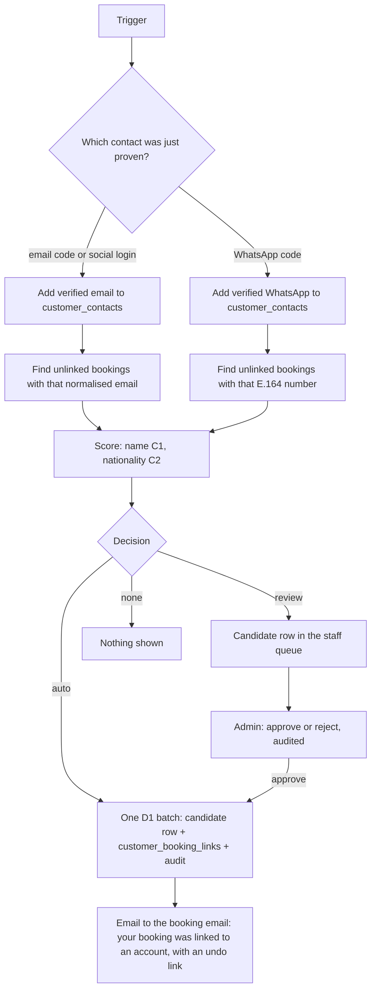
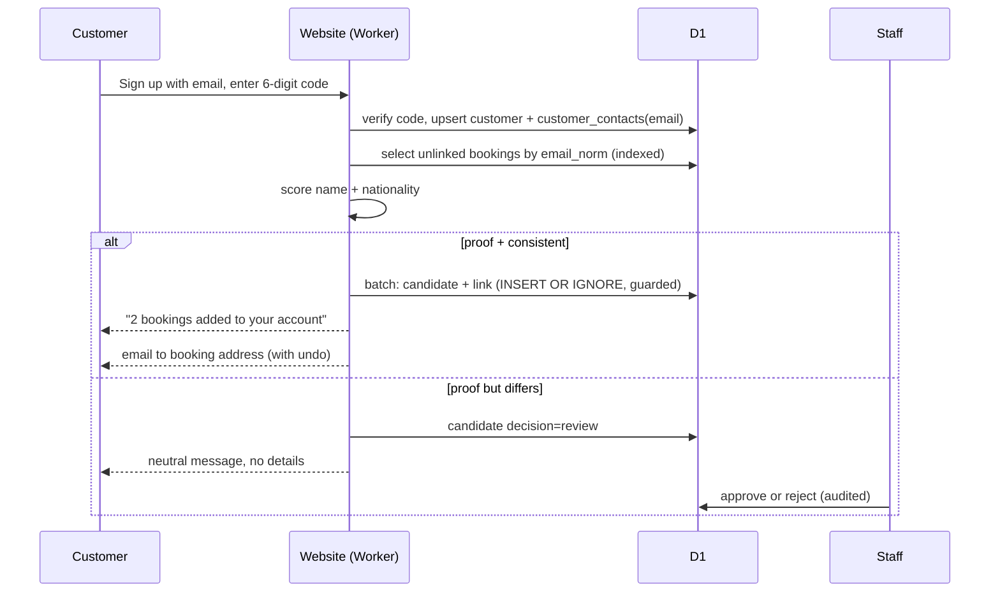

# Linking existing bookings to a new account

Status: **design for owner approval, nothing is built yet.** Money, customer data and sign-in are involved, so the open decisions in section 11 must be answered before the build starts. Everything ships behind a Worker variable that is off until the owner turns it on (`BOOKING_ACCOUNT_MATCH=1`).

## 1. Goal

A customer who booked as a guest, then creates an account, should find their past and upcoming bookings in the account without contacting us. The match uses **customer name, nationality and either email or WhatsApp**.

Non-goals: merging two accounts, changing a booking's contact details, linking bookings of other people (family, colleagues) by guess, any change to prices or payments.

## 2. What exists today (facts from the code)

- A booking belongs to an account when a row exists in `customer_booking_links`, **or** when `lower(bookings.customer_email)` equals the account's email and the booking has no link (`ownedBy` in `lib/customer-auth.ts`). The account's email is proven by the 6-digit email code or by the social provider.
- There is **no nationality** on bookings or customers.
- `bookings.customer_phone` is free text and **not verified**. There is no verified WhatsApp number on an account yet.
- `customer_booking_links.booking_reference` is the primary key: a booking can have one owner.

So the "email" part works already for an exact verified email. The new system adds: name and nationality as consistency checks, a verified WhatsApp route, a review queue for near matches, audit, and a way to link when the booking email differs from the sign-up email.

## 3. The security rule everything else follows

**Name and nationality are not secrets. They never prove who someone is.** Anyone can type "Sarah Müller, German" into a sign-up form. If those could link a booking, a stranger could read another person's pickup address, flight, phone and driver.

Therefore:

- A link needs **proof of control** of a contact in the booking: a verified email (code or provider) **or** a verified WhatsApp number (a code sent over WhatsApp).
- Name and nationality are **consistency checks on top of proof**, used to catch the wrong person who happens to share a mailbox or phone (a shared family email, a travel agent's number).
- An unverified phone typed at sign-up is **never** proof.
- Responses never reveal whether a booking exists ("we linked 2 bookings" is shown only after a link; otherwise a neutral message). This stops anyone using the screen to find out who has booked.

## 4. Evidence and decisions

| Evidence | Meaning |
|---|---|
| **P1** verified email equals the booking's email (normalised) | proof |
| **P2** verified WhatsApp number equals the booking's WhatsApp or phone (E.164) | proof |
| **C1** name matches | consistency |
| **C2** nationality matches (only when the booking has one) | consistency |

Name matching: Unicode NFKC, case and accent folded, punctuation removed, word order ignored ("Müller Sarah" = "Sarah Muller"), initials allowed ("S. Muller"), at most one typo per word of 5+ letters. Thai and Chinese names compare exactly after normalisation. Nationality is stored as an ISO 3166-1 code; "Thai", "Thailand" and "TH" are the same.

| Case | Decision |
|---|---|
| P1 or P2, C1 matches, C2 matches or the booking has no nationality | **auto-link** |
| P1 or P2, but name or nationality differs | **hold for staff review** (nothing shown to the customer) |
| no proof (only name and nationality, or an unverified number) | **no link**, no hint that a booking exists |
| booking already linked to another account | **hold for staff review**; never moved automatically |

Cancelled or unpaid ("pending_payment") bookings follow the same visibility rules the account already has (`ACCOUNT_VISIBLE_STATUSES`).

## 5. Data model (additive; each table also has a `CREATE TABLE IF NOT EXISTS` bootstrap, because Workers Builds does not run migrations)

- `customer_contacts(customer_id, kind 'email'|'whatsapp', value_norm, verified_at, method, UNIQUE(kind, value_norm))`: the verified contacts of an account. One verified contact belongs to one account.
- `customers.nationality` (ISO code, optional, set by the customer) and `bookings.customer_nationality` (optional, asked at checkout; see decision 1).
- `booking_match_candidates(id, customer_id, booking_reference, proof 'email'|'whatsapp', name_result, nationality_result, decision 'auto'|'review'|'rejected', decided_by, decided_at, reason, created_at, UNIQUE(customer_id, booking_reference))`: every evaluation, append-only, no personal data beyond references (names are not copied).
- `customer_booking_links` stays the single source of "who owns this booking". Writing it is `INSERT OR IGNORE` guarded by "no existing link", in one D1 batch with the candidate row, so a retry or two requests at once cannot double-link or steal.

Normalised lookup columns (`customer_email_norm`, `customer_phone_e164`) are indexed on `bookings`, so matching reads a handful of rows instead of scanning.

## 6. Workflow

Triggers (all call the same `matchBookingsForCustomer(customerId)`):

1. **Contact verified**: sign-up or sign-in code, social login, WhatsApp code.
2. **New booking**: after a booking is created for an email or number that already belongs to a verified contact (reverse match), so a repeat customer's new booking appears at once.
3. **Account page "Find my bookings"**: the customer adds a WhatsApp number, receives a code over WhatsApp, and the match runs.
4. **Repair sweep** (the existing every-minute cron, a few rows per run): re-evaluates candidates left half-done, never auto-links something that now conflicts.

## 7. Idempotency, concurrency, failure

- Every write is keyed by `(customer_id, booking_reference)`; replays do nothing new.
- Two accounts racing for one booking: the first valid link wins; the second becomes a `review` candidate. Staff are the only way to move a link, with a reason.
- The auto-link and its audit row commit together or not at all (one D1 batch). If the notification email fails, the link stands and the email is retried from the outbox.
- A failed or half-done evaluation is repeated by the sweep; the end state is the same.

## 8. Abuse and privacy (PDPA)

- Rate limits: per customer, per IP and per number for code requests and "Find my bookings"; code attempts capped (5), WhatsApp codes expire in 10 minutes, same as the email code. Turnstile on the sign-up page.
- Collect the minimum: nationality is optional, used only for matching and never shown on public pages; it is not sent to AI models or logged.
- Never log names, emails, numbers or nationalities; logs carry references and decisions only.
- The booking's email owner is told when a booking is linked, and can undo the link.
- Staff actions on the review queue are role-checked on the server and audited. A denied-role test is required.

## 9. Staff screen

Admin → Customers → **Booking matches**: pending candidates with what matched and what differs (name shown masked until opened), buttons Approve / Reject / Unlink, and a reason box. Counts of auto, review and rejected per day, with an alert when review or rejected spikes (a sign of probing).

## 10. Rollout (each phase is a small PR, flag off until verified)

1. **Foundation**: normalisers (email, E.164, name, nationality) as pure modules with tests; tables and bootstraps; candidate evaluation; no linking yet.
2. **Email proof**: link by verified email plus name check; review queue; undo; audit; notification email. No nationality needed.
3. **Nationality**: optional field at checkout and on the profile; scoring rule C2.
4. **WhatsApp proof**: code over WhatsApp (needs the Meta WhatsApp connection live and `WHATSAPP_*` secrets); "Find my bookings".
5. **Reverse match and sweep**: new bookings for known contacts; repair cron.

Tests per phase: auto-link happy path, denied (no proof), name mismatch to review, nationality mismatch to review, shared mailbox, booking already linked, retry, two accounts at once, wrong staff role, rate limits, no leakage in responses, and a Miniflare D1 journey test.

## 11. Decisions needed from the owner before the build

1. **Nationality at booking**: ask for it (optional) at checkout from now on? Existing bookings have none, so they can only match on proof plus name.
2. **Near matches** (proof but name or nationality differs): staff review (recommended) or no link at all?
3. **WhatsApp proof**: build it after the Meta WhatsApp connection is live (recommended), or only email for now?
4. **Different emails**: if the customer signs up with another email than the booking's, may they link by a WhatsApp code to the number on the booking (recommended), or by contacting staff only?
